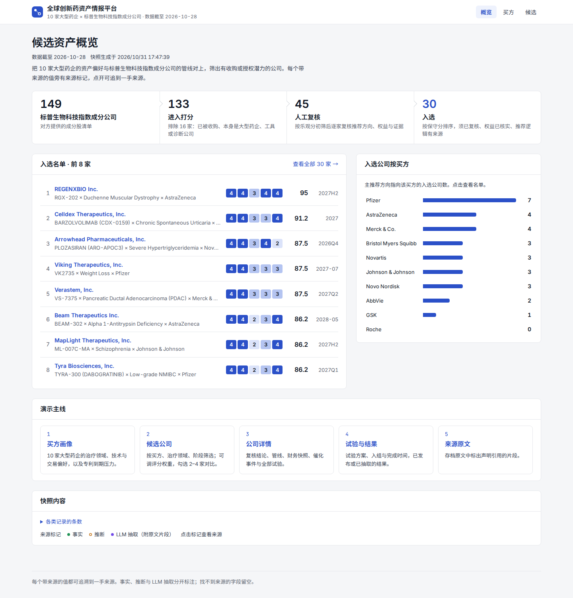

# 全球创新药资产情报平台

横店资本 FDE 技术作业。把 10 家大型药企（买方）的资产偏好，与标普生物科技精选行业指数 149 家成分公司（标的）的管线对上，筛出 30 家有收购或授权潜力的公司；交付数据文件、可运行的应用样板与文档。

核心原则是**可追溯**：快照中的每个数值、日期、临床结论都挂一个来源 ID，能回到一手来源（ClinicalTrials.gov、SEC EDGAR、openFDA、公司公告、论文）；每条记录区分事实与推断，推断附置信度；找不到来源的字段留空并记入缺口清单。



**5 分钟看懂整个做法：** [`docs/流程说明.html`](docs/流程说明.html)（七个步骤，每步做什么、用了程序、AI 还是人工；下载后用浏览器打开）

## 交付物

| 题面第四部分 | 文件 |
|---|---|
| 1. 可运行的应用样板及运行说明 | 本文件「运行」一节；访问地址见下（需密码） |
| 2. 《候选生物制药公司列表》Excel | [`deliverables/候选生物制药公司列表.xlsx`](deliverables/候选生物制药公司列表.xlsx) |
| 3. 应用开发方案或架构说明 | [`docs/architecture.md`](docs/architecture.md)（开工前方案：[`docs/plan.md`](docs/plan.md)） |
| 4. 源代码及必要的配置说明 | 本仓库；配置见「配置」一节与 [`.env.example`](.env.example) |
| 5. 筛选方法、数据来源和 AI 使用说明 | [`docs/scoring-rules.md`](docs/scoring-rules.md)、[`docs/data-sources.md`](docs/data-sources.md)、[`docs/ai-usage.md`](docs/ai-usage.md) |
| 6. 未完成事项、已知限制及后续开发计划 | [`docs/limitations-roadmap.md`](docs/limitations-roadmap.md) |

其他支撑材料：

- 数据核验报告：[`docs/verification.md`](docs/verification.md)（分层抽样错误率、错误逐条与处理）
- AI 使用日志：[`docs/ai-log.md`](docs/ai-log.md)（每次 AI 辅助的抽取或核验一条）
- 术语对照：[`docs/glossary.md`](docs/glossary.md)
- 演示提纲：[`docs/demo.md`](docs/demo.md)

**访问地址：** https://drug-asset-intel.onrender.com （访问密码另行提供；登录框中用户名任意）。免费实例闲置约 15 分钟后休眠，再次打开需等待约 50 秒。2026-11-01 已从中国大陆网络实测可访问。

## 结果一览

| 环节 | 数量 |
|---|---|
| 指数成分公司 | 149 |
| 排除（已被收购 3、本身是大型药企 6、工具、诊断或其他 7） | 16 |
| 进入打分 | 133 |
| 人工复核（含深度研究 5 家：ARWR、CLDX、RGNX、VKTX、VSTM） | 45 |
| 入选 | 30 |

股价取 2026-10-28 收盘；财务数值取最近一期申报的资产负债表（133 家中 127 家截至 2026-06-30）；复核引用的文档截至 2026-10-29。

## 运行

### 一条命令启动（推荐）

需要 Docker。

```bash
docker compose up --build
```

打开 http://localhost:8000 。镜像内已包含数据快照与前端，不需要任何密钥，不联网取数。

### 本地开发

需要 [uv](https://docs.astral.sh/uv/)（Python 3.12）与 Node.js 24。

```bash
uv sync                          # 安装 Python 依赖
cd web && npm install && npm run build && cd ..
uv run intel serve               # http://127.0.0.1:8000 ，同时托管前端
```

前端热更新开发：另开终端 `cd web && npm run dev`（代理 `/api` 到 8000 端口）。

### 测试与检查

```bash
uv run pytest                    # 全部测试
uv run ruff check .              # 代码检查
uv run intel check-provenance    # 溯源完整性：有值没来源时非零退出
uv run intel check-scoring       # 评分检验：高分有事实支撑、权重敏感性
```

### 重建数据（可选）

应用只读 `data/processed/intel.db`。从缓存与人工核实文件离线重建：

```bash
uv run intel build               # 约 30 秒，输出 gaps.csv、longlist.csv、shortlist.csv
uv run intel export              # 重新导出 Excel
uv run intel verify sample       # 分层抽样核对表
```

联网抓取与 LLM 抽取需要 `.env` 中的 SEC User-Agent 与模型密钥，命令列表见 [`CLAUDE.md`](CLAUDE.md)。

## 配置

复制 `.env.example` 为 `.env` 后按需填写。只运行应用时全部可留空。

| 配置项 | 用途 | 运行应用时 |
|---|---|---|
| `INTEL_DB_PATH`、`INTEL_WEB_DIST` | 快照与前端构建产物路径 | 有默认值 |
| `INTEL_ACCESS_PASSWORD` | 网站访问密码（HTTP 基本认证，用户名任意）；留空则不需要密码；`/api/health` 始终开放 | 可选 |
| `SEC_USER_AGENT` | SEC EDGAR 要求的联系人标识 | 不需要（仅抓取） |
| `LLM_*`、`LLM_VERIFY_*` | DeepSeek 主抽取、Qwen 交叉核验的接口与密钥 | 不需要（仅抽取） |

仓库不含任何密钥或付费数据库账号；`.env` 已在 `.gitignore` 中。

## 部署（Render）

仓库根目录的 [`render.yaml`](render.yaml) 定义了一个 Docker Web 服务（免费套餐、健康检查 `/api/health`）。

1. 在 Render 选择 New → Blueprint，连接本仓库。
2. 按提示填写 `INTEL_ACCESS_PASSWORD`（值只存在 Render，不进仓库）。
3. 部署完成后，用浏览器打开服务地址，在弹出的登录框输入任意用户名与该密码。

网站显示对方提供的买方材料，因此部署时设置访问密码。

## 目录

| 路径 | 内容 |
|---|---|
| `src/intel/` | Python 包：数据模型与溯源规则、抓取（`ingest/`）、文档存档与 LLM 抽取（`docs/`、`extract/`）、评分与筛选（`scoring/`）、导出与核验、API |
| `web/` | 前端（Vite + React + TypeScript + Ant Design） |
| `tests/` | pytest 测试 |
| `config/` | 评分权重与 EV 档位（`scoring.toml`）、LLM 价格与预算（`llm.toml`） |
| `data/raw/` | 抓取的原始响应与文档存档（带抓取时间与哈希） |
| `data/manual/` | 人工核实文件：复核文件、人工来源、调整与对照表（签字后才生效） |
| `data/processed/` | 数据快照 `intel.db` 与缺口、长名单、入选名单 |
| `deliverables/` | Excel 交付文件 |
| `docs/` | 交付文档；`docs/assignment/` 为对方原始附件（只读） |
| `openspec/` | 规格驱动开发：每个代码变更的提案、规格、设计与任务，已完成的在 `archive/` |
| `mydoc/plans/` | 变更拆分计划（v1–v6）及状态日志 |
| `.claude/` | AI 编码助手（Claude Code）使用的技能与项目配置 |

`openspec/`、`mydoc/` 与 `.claude/` 保留在仓库中，作为 AI 辅助开发流程的原始记录，说明见 [`docs/ai-usage.md`](docs/ai-usage.md)。
