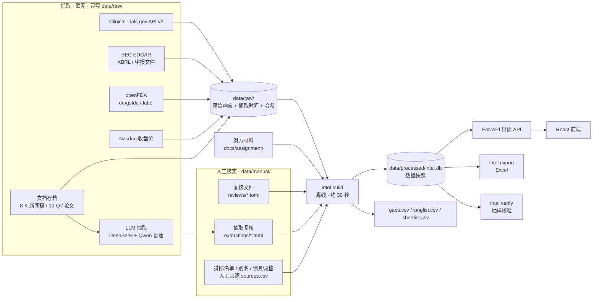
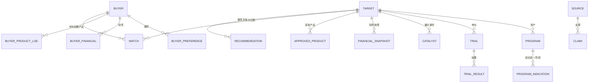
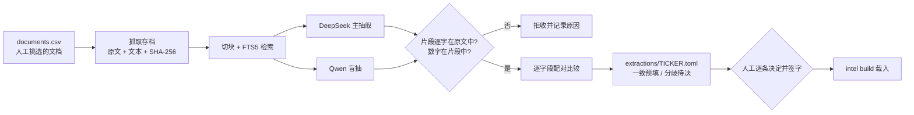

# 架构说明

本文描述已经建成的系统。开工前的方案见 [`plan.md`](plan.md)，两者不一致处以本文为准。术语见 [`glossary.md`](glossary.md)。

## 1. 总体结构

系统分三段：**抓取**（联网，只写原始缓存）、**构建**（离线，把缓存与人工核实文件合成一个数据快照）、**使用**（应用、Excel 导出、核验都只读快照）。

几条贯穿全局的约定：

- **构建不联网。** 同样的缓存与人工文件总能重建出同样的快照；抓取和构建分开，演示与评审不依赖外部服务是否可用。
- **快照提交进仓库。** 应用只读这一个 SQLite 文件，运行时不调用任何外部数据源；「数据更新时间」是快照里的真实字段。
- **人工文件签字才生效。** `data/manual/` 下的文件有 `verified_by` 字段，为空时构建忽略；已签字文件被程序追加内容时签字自动清空。

## 2. 数据模型

业务值存在各实体表的类型化列里；每个值的来源存在 `Claim`（声明）里，指向 `Source`（来源登记）。

| 表 | 内容 | 记录数 |
|---|---|---|
| `buyer`、`buyer_preference`、`buyer_financial`、`buyer_product_loe` | 10 家买方：画像、资产偏好、财务、美国专利到期产品（来自对方材料，保留其来源 ID） | 10 / 60 / 10 / 38 |
| `target` | 149 家成分公司：CIK、排除标记与原因、研究状态、是否入选 | 149 |
| `program`、`program_indication` | 资产（药物）与「适应症 × 研发阶段」，由 CT.gov 推导、openFDA 与人工修正 | 1,330 / 2,456 |
| `trial`、`trial_result` | 试验状态、设计、入组、预计完成日；主要终点结果（CT.gov 已发布结果 + 文档抽取） | 3,205 / 1,557 |
| `catalyst` | 公司披露的未来事件（抽取） | 24 |
| `financial_snapshot` | 现金及投资、债务、经营现金流、资金可支撑月数、股本、市值、企业价值、收购成本估算 | 133 |
| `approved_product` | 已获批产品与申请号（openFDA） | 105 |
| `match`、`recommendation` | 买方 × 公司匹配；推荐方向（资产 × 适应症 × 买方）的五维分数、保守分 / 乐观分、推荐逻辑 | 1,007 / 1,012 |
| `source` | 来源登记：类型、网址、发布者、发布日期、抓取时间、本地存档路径、内容哈希 | 约 3,900 |
| `claim` | 声明：实体 + 字段 → 来源；事实 / 推断、置信度、原文片段、产生方式（接口 / 人工 / LLM）、模型名 | 约 68,700 |

**溯源规则写在数据库层**（`db.py` 的 `before_flush` 钩子），任何写入路径都绕不过：

1. 每张实体表的 `BUSINESS_FIELDS` 列出必须有声明支撑的字段；
2. 声明必须引用已登记的来源；
3. 推断必须带置信度（高 / 中高 / 中 / 低）；
4. LLM 产生的声明必须带原文片段与模型名；
5. 枚举字段（研发阶段、技术类型、资产权益等）只收受控取值。

`intel check-provenance` 在构建后再扫一遍：有值而没有声明的字段数必须为 0。

每条声明还记录值的产生方式（`produced_by`：接口 / 人工 / LLM），抽样核验按它分层。各字段由谁产生、LLM 写了哪些字段，见 [`data-sources.md`](data-sources.md) 第 5 节。

## 3. 构建流程

`intel build` 按固定顺序执行以下步骤（`build.py`），每步可以登记缺口（找不到来源的字段），最终写出 `gaps.csv`：

| 步骤 | 做什么 |
|---|---|
| 对方材料 | 导入两份 Excel：买方画像、偏好、财务、专利到期；按对方「方法口径」表划分事实 / 推断 |
| 候选池 | 149 家成分公司映射 CIK；按签字的排除名单排除 16 家 |
| openFDA | 已获批产品与申请号；用于识别「别家公司的已上市药」 |
| CT.gov | 试验入库；按申办方别名与研发代号前缀归属公司；由干预推导资产与「适应症 × 阶段」 |
| 已上市阶段 | 按 FDA 说明书适应症把已获批资产的阶段改为已上市 |
| 财务 | SEC XBRL 按标签优先级取现金、债务、经营现金流、股本；Nasdaq 收盘价算市值；人工债务调整计入企业价值 |
| 治疗领域 | 适应症按关键词表归入 14 个治疗领域 |
| 评分与复核 | 自动初筛五维评分；载入签字的复核文件覆盖对应字段；按入选规则生成入选名单 |
| 抽取结果 | 载入签字的 LLM 抽取复核文件，对应到资产与试验 |

评分方法见 [`scoring-rules.md`](scoring-rules.md)。

## 4. LLM 抽取流程

只用于官方接口拿不到的内容（作用机制、新闻稿中的临床结果、公司披露的读出与申报时间）。

- 每次调用记入账本（模型、token、费用）；超过预算上限即停止；DeepSeek 高峰时段默认拒绝运行。
- `intel extract --replay` 用保存的模型回复重新校验与配对，调整规则时不重复付费。

## 5. 应用

- **后端**：FastAPI，只读打开快照；接口返回值时同时返回支撑它的声明与来源，前端据此标出来源圆点（实心 = 事实，空心 = 推断）并跳转。
- **接口**：`/api/health`、`/api/meta`、`/api/shortlist`（可带五维权重重排，不改快照）、`/api/buyers`、`/api/buyers/{ticker}`、`/api/targets/{ticker}`、`/api/trials/{nct_id}`、`/api/sources/{source_id}` 与 `/api/sources/{source_id}/text`（来源登记、存档原文与片段位置）。
- **前端**：Vite + React 19 + TypeScript + Ant Design 6；概览、候选列表与对比、公司详情（管线、试验、临床结果、推荐方向）、买方、试验、来源原文（高亮引用片段）共 8 类页面。
- **部署**：一个 Docker 镜像同时托管 API 与前端（`Dockerfile`、`compose.yaml`）；Render 用 `render.yaml`。可选访问密码（`INTEL_ACCESS_PASSWORD`，HTTP 基本认证，健康检查除外）。

## 6. 关键技术选择

| 选择 | 理由 | 放弃的方案 |
|---|---|---|
| SQLite 单文件快照 | 数据量小（约 7 万条声明）；可提交进仓库、可随镜像分发、可重建 | PostgreSQL：需要单独服务，演示不稳定 |
| 声明表（Claim）与业务表分离 | 一个值可以有多个来源；事实 / 推断、置信度、原文片段统一存放；页面、Excel、核验都从这一张表取来源 | 每个字段旁加 `_source` 列：表结构翻倍，无法表达多来源 |
| 结构化字段只走官方接口 | 可程序比对原始响应，抽样 0/30 错误 | 让 LLM 读网页填全部字段 |
| 两家厂商的模型盲抽交叉核验 | 不同模型的错误不完全相关；分歧即人工复核点 | 单模型 + 自我检查 |
| 人工文件签字作为入库闸门 | 研究结论涉及判断，需要明确的责任人 | 直接入库 AI 草稿 |
| 股价用 Nasdaq 接口 | SEC 不提供股价；Stooq 实测需要浏览器验证 | Stooq、Yahoo（非官方且不稳定） |
| uv、Vite、Ant Design | 依赖锁定、构建快；中文表格与筛选组件成熟 | — |

## 7. 扩展方式

- **增加一类数据源**：在 `ingest/` 加一个抓取函数（写 `data/raw/`）和一个构建步骤（登记来源、写声明）；溯源钩子自动约束它。
- **扩大研究范围**：复核文件与抽取复核文件是按公司独立的 TOML，45 家复核由并行子代理起草，扩到 133 家只是增加文件与签字工作量，代码不变。
- **定期更新**：抓取命令支持 `--only` 与 `--refresh`；对比两次快照即可生成变化清单（试验状态、读出日期、新增债务）。
- **多用户**：当前是单一只读快照；需要在线审核时，把签字流程从文件改为数据库表加审核界面（见 [`limitations-roadmap.md`](limitations-roadmap.md)）。

## 8. 开发方式

- **规格驱动**：每个代码变更先在 `openspec/changes/<name>/` 写提案、规格（需求 + 场景）、设计与任务，实现后逐条核对再归档；主规格在 `openspec/specs/`（16 份）。已完成 11 个变更。
- **变更计划**：`mydoc/plans/drug-asset-intel/` 记录需求拆分（v1–v6）与每次状态变化。
- **测试**：302 项 pytest 用例，对应规格中的场景；`ruff` 检查代码风格。
