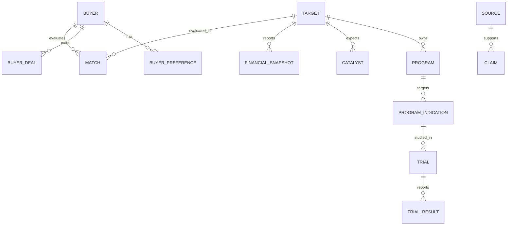
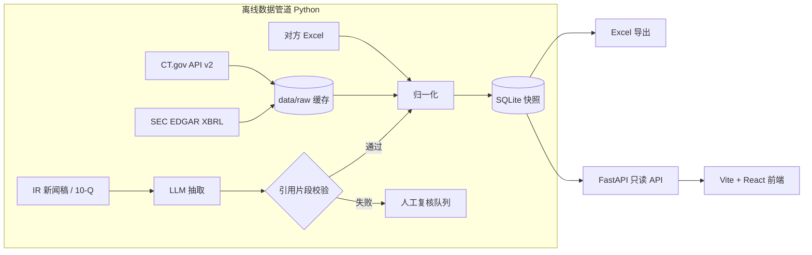

# 应用开发方案（v1 草案）

> 状态：草案，2026-10-28。本文同时是交付物 3「应用开发方案或架构说明」的底稿，随实施更新。
> 术语解释见 [`docs/glossary.md`](glossary.md)。

## 1. 目标与边界

**一句话**：把 10 家 MNC（买方）的资产偏好与 149 家标普生物科技成分公司（标的）的管线对上，筛出 20–30 家有收购 / 授权潜力的公司；每个数据点可追溯到一手来源。

**7 天内做**

- 规则排除 + 加权评分，筛出 20–30 家候选，方法与依据成文
- 数据模型完整；结构化字段（试验、财务）对全部候选自动填充；3–5 家深度填充（临床数据 vs 标准治疗、催化事件、收购成本估算）
- 《候选生物制药公司列表》Excel 由数据库导出（单一事实来源）
- Web 样板覆盖题面 6 项能力，部署一个只读演示站
- 抽样核验报告 + AI 使用日志

**明确不做（留给"再给 4 周"）**

- 149 家全量深度研究、定时增量更新、变更提醒
- 用户体系 / 权限 / 在线编辑与审核流
- 非美国申报主体（20-F / IFRS）财务的完整归一化
- 收购概率的量化模型（只给定性匹配与成本区间）

## 2. 数据模型

| 实体 | 关键字段 | 主要来源 |
|---|---|---|
| Buyer | 名称、ticker、财务与战略信号、专利悬崖 | 对方 Excel（保留其来源ID） |
| BuyerPreference | 治疗领域 / 技术类型 / 阶段偏好、排序、置信度 | 对方 Excel 第 2–4 表 |
| Target | ticker、CIK、名称、排除标记与原因、入选理由 | 指数清单 + SEC |
| Program | 药物代号、作用机制（MoA）、技术类型（modality） | 公司 IR / 10-K |
| ProgramIndication | 适应症、研发阶段（归一化枚举） | IR、CT.gov |
| Trial | NCT 号、阶段、状态、设计、入组目标 / 实际、预计主要完成日、预计读出 | ClinicalTrials.gov API v2 |
| TrialResult | 终点、结果、对照 / 标准治疗、相对优势 | 新闻稿、会议摘要、CT.gov results |
| Catalyst | 事件、预计时间窗、类型（读出 / 申报 / 获批） | 公司指引 |
| FinancialSnapshot | 现金及投资、债务、经营现金流、资金可支撑期、股本、市值、截至日 | SEC EDGAR XBRL；股价另标来源 |
| Match | 买方×标的、匹配分、理由、置信度 | 分析推断 |
| Source | source_id、URL、类型、发布日期、抓取时间 | — |
| Claim | 实体+字段、值、fact / inference、置信度、原文片段、source_id | — |

**关键设计**：任何业务字段都通过 Claim 关联到 Source。前端的"跳转来源"、Excel 的来源列、核验抽样，都从 Claim 这张表取数。

## 3. 筛选方法

**Stage 0：规则排除（每条记录排除原因）**——以下为草案，入文档前逐个核实：

- 已被收购或交易待完成：例如 APGE（对方材料载明 AbbVie 已完成收购）
- 买方体量的大型药企：ABBV、AMGN、GILD、REGN、VRTX、BIIB
- 工具 / 诊断 / 平台服务，非药物资产：TWST、NTRA、GRAL、VCYT、MYGN 等

大型商业化公司（如 INCY、BMRN、NBIX、UTHR、EXEL）**不排除**，在评分中落入"高收购成本"档，由买方体量决定可行性。

**Stage 1：推荐方向评分（全部标为推断）**——细则见 [`docs/scoring-rules.md`](scoring-rules.md)

- **评分对象**：每家公司选一个推荐方向（主推荐资产 × 适应症 × 主要买方）。五个维度都对同一推荐方向打分；公司分 = 主推荐方向分。其他方向放详情页，不计分。
- **五个维度**（0–4 分，每档写明证据要求）：

| 维度 | 评什么 | 初始权重 |
|---|---|---|
| 买方契合度 | 具体买方 × 具体资产 × 具体需求（对方材料的目标资产画像、LOE 缺口）；只按标签匹配最高 2 分 | 30% |
| 研发阶段匹配度 | 资产阶段与该买方偏好阶段的距离；不默认越晚越好 | 20% |
| 临床证据与差异化 | 研究设计、可比性、结果、局限；跨试验比较最高 3 分 | 20% |
| 近期催化 | 24 个月内事件的重要性 × 时间确定性（明确披露 / 登记估算） | 15% |
| 可交易性 | 成本按 EV 档位计分；资产权益为入选门槛；资金紧张只做提示，不解释为容易收购 | 15% |

- **吸引力与研究充分程度分开**：保守分（缺失按 0 计）、乐观分（缺失按满分计）、证据覆盖率（10 个必需字段）、研究状态（自动初筛 / 已复核 / 深度研究）分别展示。
- **流程**：133 家按乐观分初筛 → 约 40 家复核 → 按保守分取 20–30 家（须已复核、权益已核实、推荐逻辑有来源）→ 3–5 家深度。
- **列表默认列**：公司、核心资产及适应症、潜在买方及匹配理由、临床证据与差异化、下一关键事件、交易障碍、研究状态、吸引力分（辅助排序）。
- 权重写进配置文件，前端可调；首批约 10 家复核后做样例检验，再决定是否调整权重。

## 4. 架构与技术栈

- **后端**：Python 3.12（uv 管理版本与依赖）、FastAPI、SQLite（SQLModel），一个 Docker 镜像同时托管 API 和前端静态文件
- **前端**：Vite + React + TypeScript；表格和筛选用 Ant Design（中文场景成熟）
- **部署**：Render 免费层（演示前预热，规避冷启动约 50 秒）；本地备用 `docker compose up`
- **关键决策**：演示站只读取已提交的数据快照，运行时不调用外部 API，保证演示稳定，也让"数据更新时间"成为真实字段

## 5. 数据管道与质量控制

1. **结构化优先**：试验和财务数据从官方接口拉取，原始响应存入 `data/raw/`，带抓取时间
2. **LLM 抽取**：只处理非结构化文本，输出必须带原文片段；程序校验片段是否出现在源文中，不通过的进入人工复核队列
3. **归一化**：研发阶段、技术类型、治疗领域用统一枚举；公司名用别名表对齐（CT.gov 的 sponsor 名称和指数里的公司名常常写法不同）
4. **抽样核验**：人工抽查约 50 个字段，统计准确率和错误类型，写入 `docs/verification.md`
5. **AI 日志**：`docs/ai-log.md` 逐条记录每次 AI 辅助的环节与核验方式

## 6. 排期（截止 2026-11-04 周三，计划 11-03 晚提交）

| 日期 | 主要产出 |
|---|---|
| 10-28 周三 | 仓库、方案；uv 项目骨架；导入对方两份 Excel；ticker→CIK 映射 |
| 10-29 周四 | Stage 0 排除；CT.gov / EDGAR 批量拉取；别名表；确定股价来源 |
| 10-30 周五 | 评分细则定稿；自动初筛（133 家 → 约 40 家）；首批复核与样例检验 |
| 10-31 周六 | 复核其余约 30 家；确定 20–30 家与 3–5 家深度对象 |
| 11-01 周日 | 深度填充 3–5 家（临床数据、催化事件、成本估算）；前端主要视图；Excel 导出 |
| 11-02 周一 | 抽样核验与修正；部署 |
| 11-03 周二 | 文档（架构、方法、AI 使用、限制、4 周计划）；演示彩排；提交 |
| 11-04 周三 | 缓冲 |

## 7. 风险与对策

| 风险 | 对策 |
|---|---|
| 市值需要股价，SEC 不提供 | SEC 取股本（官方）× 公开行情收盘价（明确标注来源与日期，属非官方）；D2 定案 |
| CT.gov sponsor 名称与公司名不一致 | 别名表 + 人工过一遍候选名单 |
| 外国申报主体（如 QURE 用 20-F / IFRS） | 列为已知限制，手工补充少量字段 |
| Q3 财报季（11 月上旬密集发布） | 声明数据快照日期，不追最新 |
| 部署冷启动 | 演示前预热；本地备用 |
| 临床数据抽取出错 | 引用片段校验 + 3–5 家深度对象全量人工复核 |

## 8. 已定默认值

- 题面第二部分第 8 项空白为笔误（已确认）；"潜在买方匹配"仍作为核心分析保留在 Match 表中
- 评分权重按第 3 节初始值

- 置信度四档：高 / 中高 / 中 / 低（前三档与对方材料一致，"低"用于弱证据推断）
- 界面中文；药名、公司名、试验名保留原文
- EDGAR 要求 User-Agent 带联系邮箱：放在 `.env`，仓库只提交 `.env.example` 占位
